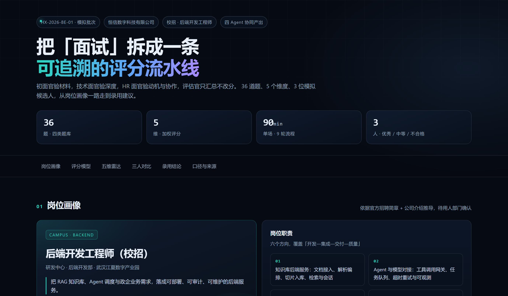

# 多 Agent 面试协同团队实践 · 恒信数字科技校招后端岗

一套由四个 AI 角色协同产出的校园招聘面试方案：岗位画像 → 题库 → 评分表 → 模拟面试 → 评估报告 → 可视化看板。

> 所有候选人、分数、公司岗位均为**模拟数据**，用于验证流程与评分模型，不对应真实个人。

---

## 一、快速开始

1. 双击 `index.html`，用浏览器打开即可查看一页看板（纯 HTML + CSS，零依赖、零构建）。
2. 按顺序阅读 `docs/00` → `docs/05`，可完整复现一次多 Agent 面试流程。
3. 所有结论的数据口径以 `docs/03-评分表.md` 为准。

```text
interview-swarm/
├─ index.html                       # 一页看板（岗位画像 / CSS 雷达 / 三人对比 / 结论）
├─ README.md                        # 本文件
├─ docs/
│  ├─ 00-团队分工.md                # 四角色职责、输入输出、交接物、RACI、异常处理
│  ├─ 01-岗位画像.md                # 职责、必备/加分能力、胜任力模型、否决项
│  ├─ 02-面试题库.md                # 36 题（技术13/项目9/行为7/HR7），含 1–5 分锚点
│  ├─ 03-评分表.md                  # 五维权重、等级、总分换算、校准与反偏差
│  ├─ 04-模拟面试记录.md            # 3 人 × 9 轮问答摘要与逐题打分
│  └─ 05-评估报告.md                # 汇总、对比、录用建议、校准与合规
├─ knowledge/                       # 四份知识库纯文本（公司/简章/HR题库/岗位题库）
└─ .codeartsdoer/skills/ai-interview-swarm/   # 原始技能包与知识库 PDF
```

---

## 二、文件与 Agent 对应关系

| 产出文件 | 主笔 Agent | 对应技能包 | 输入 | 关键交接物 |
|---|---|---|---|---|
| `docs/00-团队分工.md` | 初面官 | `interview-orchestrator` + `general-chat-officer` | 技能包 README/SKILL、四份知识库 | 角色卡、H1–H6 交接规范 |
| `docs/01-岗位画像.md` | 初面官（技术/HR 会签） | `interview-orchestrator` | `官方招聘简章`、`公司介绍` | 岗位画像、胜任力模型 |
| `docs/02-面试题库.md` | 技术面官 + HR 面官 | `technical-interview-officer`、`hr-interview-officer` | `标准化岗位题库`、`HR 通用题库`、岗位画像 | 36 题、评分锚点、来源标注 |
| `docs/03-评分表.md` | 评估官 | `talent-assessment-specialist` | 题库锚点、岗位胜任力模型 | 五维权重、换算规则、校准权限 |
| `docs/04-模拟面试记录.md` | 初面官记录 / 技术、HR 面官执行 | 三名面试官技能 | 题库、评分表、三位模拟候选人 | H1–H5 评分包、9 轮记录 |
| `docs/05-评估报告.md` | 评估官 | `talent-assessment-specialist` | H1–H5、评分表 | H6 报告、录用建议 |
| `index.html` | 评估官 | `talent-assessment-specialist`（模板改造） | 05 的数据快照 | 可视化看板 |
| `README.md` | 初面官 | `interview-orchestrator` | 全部产出 | 索引与复现说明 |

### 2.1 角色职责速查

| 角色 | 代号 | 一句话职责 | 不做什么 |
|---|---|---|---|
| 初面官 | `ORCH-INIT` | 登记、介绍、破冰、初筛、控场、汇总交接 | 不问技术深度、不下录用结论 |
| 技术面官 | `TECH-OFFICER` | 技术/项目题提问、追问、逐题打分 | 不问薪资隐私、不评价院校 |
| HR 面官 | `HR-OFFICER` | 行为/HR 题、动机与稳定性、文化匹配 | 不问技术细节、不承诺薪资 |
| 评估官 | `ASSESSOR` | 汇总五维、校准、出报告与建议 | 不接触候选人、不改原始题分 |

---

## 三、一次完整流程

```text
候选人
  │
  ▼
[初面官] 信息登记 → 公司与岗位说明 → H01/P01 初面
  │  H1 档案 + H2 初面评分 + H3 状态
  ▼
[技术面官] T01/T04/T05/T08/T11 + P03 或 P09，逐题追问
  │  H4 技术评分包（技术深度 / 工程能力 / 学习潜力-技术侧）
  ▼
[HR 面官] B01/B02/H02/H07 + H05，逐题追问
  │  H5 HR 评分包（沟通表达 / 学习潜力-HR侧 / 文化匹配）
  ▼
[评估官] 完整性校验 → 五维合成 → 校准 → 总分与等级
  │  H6 评估报告 + index.html
  ▼
推荐 / 待定 / 淘汰
```

**硬规则**
- 同一时刻只有一个角色对候选人说话；评估官全程静默。
- 上一角色未发 `CONTROL_RETURN`，下一角色不得激活。
- 交接包字段缺失时退回补录，不猜填。
- 原始题分不可改；维度校准须留痕。

---

## 四、评分口径

| 维度 | 权重 | 主评人 |
|---|---:|---|
| 技术深度 | 25% | 技术面官 |
| 工程能力 | 25% | 技术面官 |
| 沟通表达 | 15% | HR 70% + 初面 30% |
| 学习潜力 | 20% | 技术 50% + HR 50% |
| 文化匹配 | 15% | HR 80% + 初面 20% |

```text
总分 = (技术×0.25 + 工程×0.25 + 沟通×0.15 + 学习×0.20 + 文化×0.15) × 20
```

| 总分 | 等级 | 建议 |
|---:|---|---|
| ≥90 | A | 推荐（优先） |
| 85–89.9 | A- | 推荐 |
| 80–84.9 | B+ | 推荐 |
| 70–79.9 | B | 待定 |
| 60–69.9 | C | 待定（需补测） |
| <60 | D | 淘汰 |

---

## 五、本批次结论（模拟）

| 候选人 | 五维（技术/工程/沟通/学习/文化） | 总分 | 等级 | 建议 |
|---|---|---:|---|---|
| 陈亦然 | 4.6 / 4.4 / 4.3 / 4.6 / 4.3 | **89.2** | A- | **推荐** |
| 周子航 | 3.4 / 3.2 / 3.7 / 3.9 / 3.6 | **70.5** | B | **待定（补测）** |
| 李文博 | 2.0 / 2.0 / 1.8 / 1.8 / 1.7 | **37.7** | D | **淘汰** |

**批次建议**：录用 1 人（陈亦然），保留 1 名备选（周子航，补测通过后生效），淘汰 1 人（李文博）。详见 `docs/05-评估报告.md`。

---

## 六、知识库使用与来源映射

| 知识库文件 | 用途 | 落点 |
|---|---|---|
| `knowledge/公司介绍.txt` | 公司规模、业务、技术底座、福利与晋升 | `01` 岗位背景、`H04` |
| `knowledge/官方招聘简章.txt` | 业务赛道、用工说明、岗位要求、晋升通道 | `01` 岗位画像、`H04` |
| `knowledge/HR综合通用面试题库.txt` | 3 道通用题（动机、抗压、规划） | `H01`、`H02`、`B01`、`B02`、`B06`、`H07` |
| `knowledge/标准化岗位面试题库.txt` | 技术题（Agent/RAG/大模型/算法/视觉） | `T04`–`T09`、`T13`、`P03`、`P08`、`P09`、`B07` |

- 题库 36 题中 **18 题（50%）** 标注〔知识库〕或〔知识库·转译〕，可直接回查知识库原题号与参考答案。
- 招聘简章未单列「后端开发工程师」，`01` 已注明推导依据；正式启用前需用人部门确认。
- 视觉题库（YOLO 等）与后端岗关联弱，未强行纳入，避免「为凑题量而跑题」。

---

## 七、复现与校验

1. **看板**：双击 `index.html`，无需安装任何依赖；也可用 `python -m http.server` 起本地静态服务。
2. **分数复核**：用 `docs/03` 的公式手算 `docs/04` 的维度分，应与 `docs/05` 的总分一致（89.2 / 70.5 / 37.7）。
3. **流程复核**：对照 `docs/00` 的交接物表和 `docs/04` 第五节的流程记录，检查「单发言人、按序交接、字段完整」三条硬规则。
4. **题库覆盖**：按 `docs/01` 第六节的考察矩阵，确认五维均有题覆盖，且技术面五个面（基础/数据/接口/检索/部署）无缺口。

---

## 八、已知局限

- 三位候选人为模拟样本，不能用于验证面试的预测效度。
- 评分由 AI 角色完成，缺少人类面试官交叉复核；正式流程建议加一名人类复核官。
- 简历背调、薪资带宽、录用审批不在本实践范围内。
- 题库对「后端岗」的适配基于推导，需用人部门确认技术栈（Java/Go/Python/Node 的选择会影响题目深度）。
- 看板为静态展示，不含交互与数据录入；如需批量管理候选人，应另建系统，而不是在 HTML 里堆逻辑。

---

## 九、许可与致谢

- 方法论与角色信号协议参考 `.codeartsdoer/skills/ai-interview-swarm`（AI 面试天团技能包）。
- 公司与岗位信息来自 `knowledge/` 四份知识库，仅用于本实践。
- 本产出为方案与演练材料，不构成任何真实录用承诺。